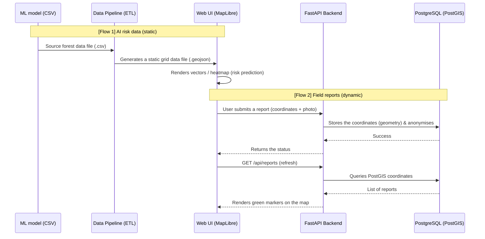

# Data Flow & Display Architecture

This document describes the data flow of the Gia Lai deforestation-warning Web GIS, from the moment raw data comes in to its display and interaction on the map (frontend). It is meant to help the team verify how the system works so it can present it confidently to the competition judges.

---

## 1. High-Level Data Flow

The system runs two main data flows in parallel and combines them on the map:
- **Flow 1 (static data — AI predictions):** deforestation-risk results from the machine-learning/statistical model (as CSV) are converted and drawn on the map.
- **Flow 2 (dynamic data — crowdsourcing):** data from users (field reports, photos) is sent to the server, stored in the database and returned to the map in real time.

---

## 2. Flow 1 in Detail: Risk Prediction Data (AI Analytics Flow)

This is the core value of the project for the competition. The risk data is displayed efficiently in these steps:

### Step 2.1. Input
The machine-learning model's results are exported as a `.csv` table.
It contains coordinates (latitude, longitude) and the attributes linked to deforestation risk:
- **Elevation**
- **Slope**
- **Tree Cover 2000** (forest cover)
- **Annual Rainfall** (mean)
- Other indicators (NDVI, loss year…)

### Step 2.2. Pre-processing (data pipeline)
A Python script (`data-pipeline/csv_to_geojson.py`) performs the ETL (extract, transform, load):
1. **Extract:** read the `.csv` file.
2. **Transform:** turn the coordinates into spatial features (geometry points/polygons) and pack every attribute column into each feature's `properties`.
3. **Load:** write `grid_data.geojson` directly into the frontend's `public/data/` folder so it is served as fast as possible without going through the database.

### Step 2.3. Display & interaction (frontend visualisation)
When a user opens the site:
1. **Map loading:** Next.js loads `MapLibre GL JS` and downloads the `.geojson` file to the browser.
2. **Risk map rendering:** MapLibre draws the data as layers (a circle layer or a heatmap) driven by the risk score.
3. **Interactive real-time filtering:** this is the system's showcase. The user moves four sliders: *slope, elevation, tree cover, rainfall*.
   - Each slider move triggers a filter expression (`filterExpression`).
   - MapLibre evaluates the expression against the GeoJSON `properties` right in the browser (client-side) at 60 frames per second.
   - The risk layer hides or shows cells instantly, leaving the areas that meet the chosen environmental conditions.

---

## 3. Flow 2 in Detail: Crowdsourced Data

To show real-world use, users (rangers, residents) can file a report when they see forest being cleared.

### Step 3.1. Submitting a report
1. The user clicks the map where they suspect clearing.
2. A form asks for a comment and an on-site photo (image).
3. The frontend packs the data and coordinates with `FormData()` and sends them by HTTP `POST /api/reports` to the backend (FastAPI).

### Step 3.2. Backend processing
1. **Image handling:** FastAPI receives the image, checks the format (only `png/jpg`) and saves it as a static file in the server's `uploads/` folder.
2. **Security & anonymity:** the sender's IP address is one-way hashed with a secret `SALT` to protect the reporter's privacy.
3. **Spatial storage:** the longitude and latitude are wrapped in a `WKTElement` and stored in PostgreSQL (with the PostGIS extension).

### Step 3.3. Showing it on the map
1. As soon as the report is saved, the frontend requests fresh data (`GET /api/reports`).
2. The backend queries `PostGIS` for all reports, converts each `Geometry` back to longitude/latitude and returns the array.
3. The frontend receives the data and pins green warning markers on the map.
4. When the judges or a user click a marker, a popup shows the time, the photo and the comment of that report.

---

## 4. Verification Checklist (for the competition)
For a convincing presentation, the team should check and present in this order:
- [ ] **Data check:** show the original `.csv` produced by the ML model and the `.geojson` file produced by the pipeline.
- [ ] **Interactive check:** move the four sliders so the judges see the risk areas on the map change instantly with the biophysical/geographic parameters (proof that the map shows real model data, not a static image).
- [ ] **Live action:** click on a forest area, upload a photo and write a note. Then reload the page to show that the spatial database works and the photo comes back.
