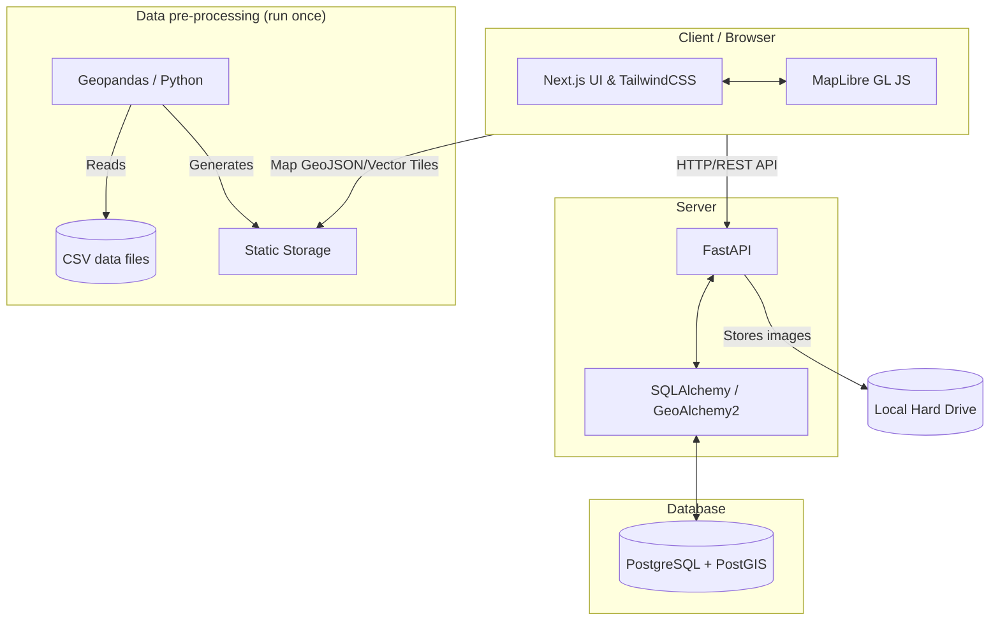

# Technical Requirements (TRD) & System Architecture

This document sets out the system architecture, the detailed technical choices and the folder structure for building the Gia Lai Deforestation Warning Map platform. The platform lives in a folder that is completely separate from the existing machine-learning code.

## 1. System Architecture

The system follows a **client–server** architecture with a **spatial database**, so the map stays smooth and check-in coordinates can be stored. The frontend and the backend are deployed on the same server.



### Main components:
1. **Frontend (Next.js):** manages the interface, tabs and sliders, renders the map with MapLibre GL JS and handles user interaction.
2. **Backend (Python, FastAPI):** handles image uploads (saved directly to disk), receives comments, hashes IPs for anonymity and queries the check-in points from the database for the frontend. FastAPI was chosen for its performance, async support and automatic API documentation (Swagger).
3. **Database (PostgreSQL + PostGIS):** a robust relational database that stores check-in coordinates as spatial points (Geometry Point).
4. **Data pipeline:** a standalone script (run once, or whenever new data arrives). It reads the `CSV` files, generates static GeoJSON files and places them in the frontend's static folder to render the 1 km map.

---

## 2. Technical Requirements

### 2.1. Project folder structure
The original layout kept all web code isolated in a `web-gis/` folder at the root of the ML project (this repository holds the contents of `web-gis/`):
```text
deforestation-risk-ai/
├── data/                  # Existing ML data
├── docs/                  # Existing ML documentation
├── web-gis/               # WEBSITE FOLDER
│   ├── docs/              # Website documentation
│   ├── frontend/          # Next.js (React) source
│   ├── backend/           # Python backend (FastAPI) source
│   └── data-pipeline/     # Python scripts converting CSV -> map
└── ...
```

### 2.2. Frontend specifications
*   **Framework:** Next.js (App Router).
*   **Language:** TypeScript for type safety.
*   **Styling:** TailwindCSS for fast UI building.
*   **Map:** MapLibre GL JS (open source, completely free, no API key needed unlike Mapbox).
*   **State management:** built-in React hooks.

### 2.3. Backend specifications (Python FastAPI)
*   **Framework:** FastAPI.
*   **Database ORM:** SQLAlchemy with GeoAlchemy2 (for PostGIS data).
*   **Security & spam check:**
    *   The `hashlib` library hashes the user's IP address together with a secret `SALT` string. Only the hash is stored in the database, to keep reporters anonymous.
*   **Image upload handling:** the API accepts a multipart file, checks the format (only .jpg and .png), resizes it to reduce its size (with `Pillow`) and saves it directly to the `uploads/` folder on the backend server's disk (returning a URL).

### 2.4. Database schema (PostgreSQL)
One main table stores the check-ins:
*   `table: field_reports`
    *   `id` (UUID or integer, primary key)
    *   `geom` (PostGIS geometry, POINT, check-in coordinates)
    *   `comment` (text)
    *   `image_url` (varchar, local image link)
    *   `user_ip_hash` (varchar, hashed IP)
    *   `created_at` (timestamp)

### 2.5. Data pipeline specifications
The Python script:
1. Reads the current CSV file.
2. Builds a Point geometry from `lat` and `lon`.
3. Puts the attributes (NDVI, rain, loss year, elevation…) into each geometry's properties.
4. Writes the file `grid_data.geojson`.

---

## 3. Single-Server Deployment Plan
Because the frontend and the backend run on the same server, the flow is:
1. **Data pre-processing:** run `csv_to_geojson.py` to produce the `.geojson` file in the frontend's `public` folder.
2. **Backend:** run FastAPI with `uvicorn` (or `gunicorn` in production) on port 8000. It connects directly to PostgreSQL (on the same server or over a VPN).
3. **Frontend:** build Next.js and run it on port 3000, configured to call the API at `http://localhost:8000`.
4. **Nginx:** use Nginx as a reverse proxy pointing the domain (e.g. `gialai-forest-risk.com`) to port 3000, with the `/api` route pointing to port 8000.
